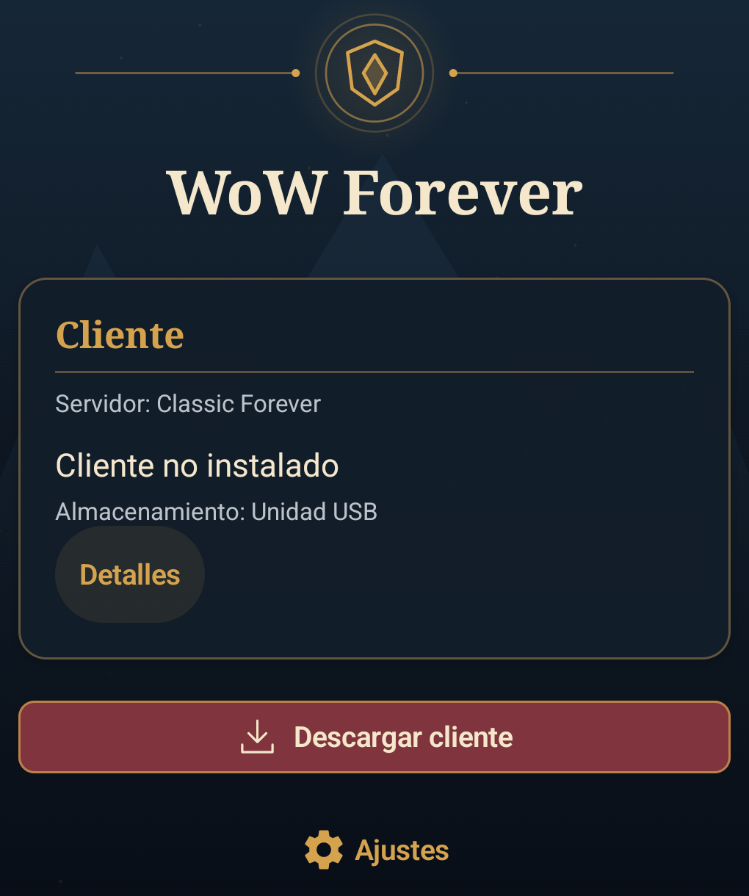
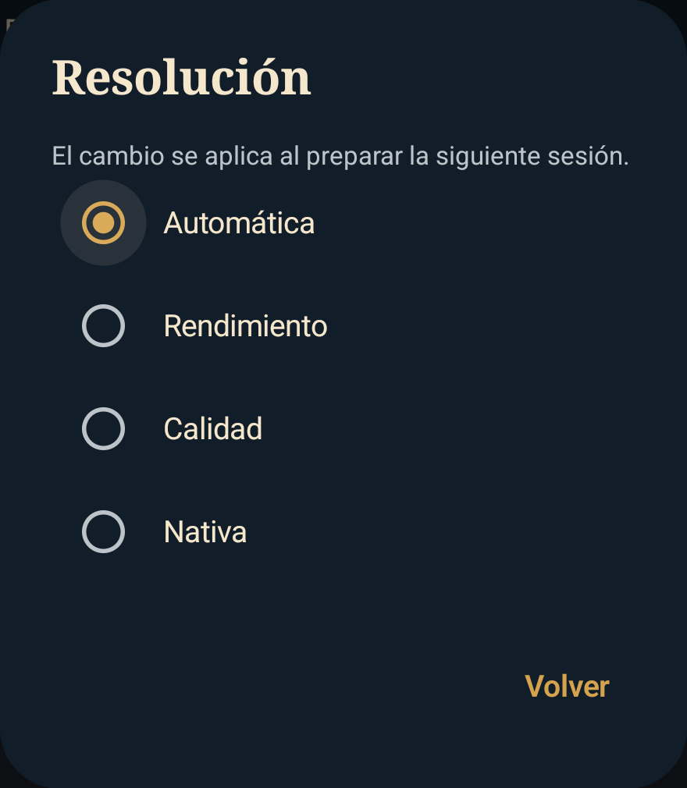

# WoW Forever for Android

An experimental project to run **WoW Classic Beta 1.60.1** on Android ARM64 and
connect to **Classic Forever**—without Battle.net or a Windows host. The project
combines a Linux client-provisioning tool, an Android launcher/runtime prototype,
and native Forever-compatibility components.

> **Experimental, not a general release.** A single-device trial reached the
> Classic Forever login and in-game entry. This does not establish long-session
> stability, measured performance, broad device support, or a one-click install.
> The game client is proprietary and is not included or redistributed here.

## Current status

Evidence snapshot: **2026-10-21**. The latest documented physical result used the
functional launcher C127 on the `xaga` device (model 22041216G; Android 14;
Mali-G610MC6) with the Windows ARM64 `1.60.1.70450` `enUS` client, Proton
11.0-90624 ARM64EC, DXVK 2.4.1-wow-aarch64-test/PanVK, and D3D11. The user confirmed
Classic Forever login and entry into the game, with no observed graphics glitches
in that test.

That result is deliberately narrow:

- No 30–60 minute session, FPS, temperature, audio, or physical-controller results
  have been recorded.
- No multi-device compatibility matrix or generally installable product release
  has been validated.
- C127 is the installed/tested launcher version. C128 and C129 have source/build
  audits, but have **not** been installed on the test phone.
- The latest documented game login was manual. APK-level protected auto-login and
  a complete one-click setup remain unvalidated.
- The client publisher's C117 download completed; this project is not currently
  reporting an active client download.

For the detailed, dated evidence and limitations, see
[`docs/launcher-app-status.md`](docs/launcher-app-status.md). The host provisioning
tool and Android ARM64 client pipeline are separate: the host tool's current
contract targets Windows `x86_64`/`enUS` builds, while `1.60.1.70450` is the
separately tested Android ARM64 client.

## Launcher preview

These are genuine captures from the functional launcher prototype, not mockups.
They show older prototype revisions (C116 and code79), with Spanish UI; they are
included to illustrate the interface, **not** to represent the current installed
build, current client state, or a release-ready app.

| Launcher home | Display resolution settings |
|---|---|
|  |  |

## What is in this repository

- **Host client provisioning:** `forever-client` resolves a CDN build and installs,
  verifies, or repairs a client using the NGDP/TACT implementation. The host
  contract currently records the Windows `x86_64`/`enUS` builds
  `1.60.1.69913`, `1.60.1.69977`, and `1.60.1.70009`.
- **Android launcher prototype:** the functional ARM64 launcher sources are under
  [`scripts/arm64-prototype/app/`](scripts/arm64-prototype/app/). It includes
  client preparation and local reuse flows, storage and display settings, and
  explicit update controls. The separate root [`android/`](android/) project is a
  diagnostic app, **not** the functional launcher.
- **Forever compatibility:** the Android path uses a native bridge and a guarded
  in-memory compatibility patch; the host Rust patcher and versioned contract
  provide related tooling and checks. The patch does not modify the installed
  executable.
- **Behavior specifications:** [`.agents/specs/`](.agents/specs/) is the source
  of truth for expected behavior. See [`AGENTS.md`](AGENTS.md) for the spec-first
  development workflow.

The Android prototype currently depends on externally provisioned, pinned build
inputs and artifacts; this repository does not provide a simple self-contained
Android build or a public APK download. See the
[prototype build/history notes](scripts/arm64-prototype/app/README.md) and
[launcher design](docs/launcher-design.md).

## Host setup: download a client

The provisioning CLI is for a Linux x86-64 development host, with Python 3.12 or
newer managed by [`uv`](https://docs.astral.sh/uv/). From a repository checkout:

```bash
uv sync
uv run forever-client --help
uv run forever-client resolve
uv run forever-client install /path/to/client
uv run forever-client verify /path/to/client
uv run forever-client repair /path/to/client
```

To install only the loose files (a small bootstrap, **not a playable full client**):

```bash
uv run forever-client install /path/to/client --loose-only
```

**Verification scope:** `forever-client verify` checks the loose files listed by
the install manifest using MD5. It does **not** verify CASC objects under `Data/`,
so it must not be treated as a complete whole-client integrity check.

**Disk space:** client size depends on build, architecture, locale, and selected
content. A historical Windows `x86_64`/`enUS` size-manifest measurement was 84.7 GB;
it is not an estimate for the separately tested ARM64 build. The
[installation findings](docs/fase-1-instalacion-cliente.md) explain the measured
variants and memory constraints. Leave substantial free space for downloads,
temporary data, and the installed client; check the selected build's manifests
rather than relying on a single fixed size.

## Development and tests

Install the development test dependency group and run the repository's tests:

```bash
uv sync --group dev
uv run pytest tests/ -q
scripts/contract-drift-check
```

The contract check compares the versioned Forever compatibility contract against
its upstream reference. Rust patcher tests are available with:

```bash
~/.cargo/bin/cargo test --manifest-path crates/forever-patcher/Cargo.toml
```

Do not run the client or Wine as root. Do not archive a live client installation;
use a completed snapshot. Keep client files, CASC data, APKs, runtime binaries, and
private device captures outside version control. See
[repository privacy](docs/repository-privacy.md) for local inputs, device selection,
and the limits of `.gitignore`.

## Project documentation

- [Product status and test evidence](docs/launcher-app-status.md)
- [Architecture baseline and decisions](docs/architecture.md)
- [Launcher design](docs/launcher-design.md)
- [Client installation findings](docs/fase-1-instalacion-cliente.md)
- [Android runtime test results](docs/android-runtime-test-results.md)
- [Documentation index](docs/README.md)
- [Forever compatibility contract](forever/contract.json)
- [Full specification set](.agents/specs/)

## License and trademarks

Project code and documentation are provided under the [MIT License](LICENSE),
unless a file states otherwise. The client and its assets remain proprietary to
their respective owners and are not included. This is an independent fan project,
not affiliated with, endorsed by, or sponsored by Blizzard Entertainment or
Classic Forever. World of Warcraft and related marks belong to their respective
owners.
